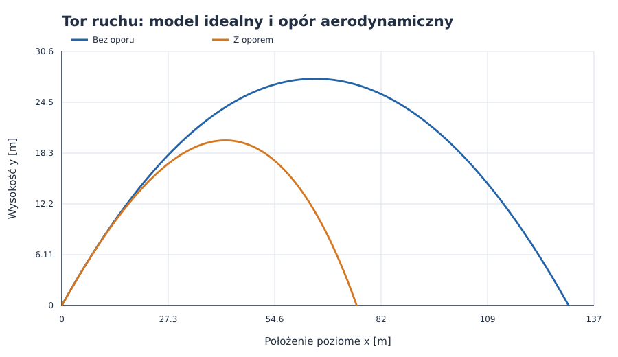
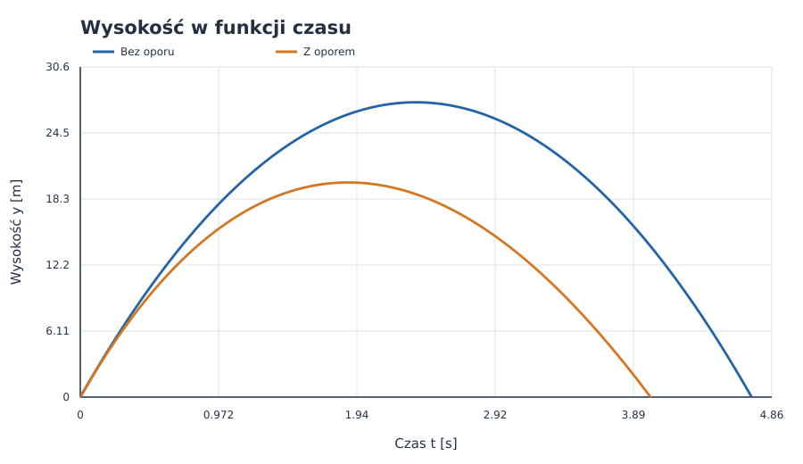
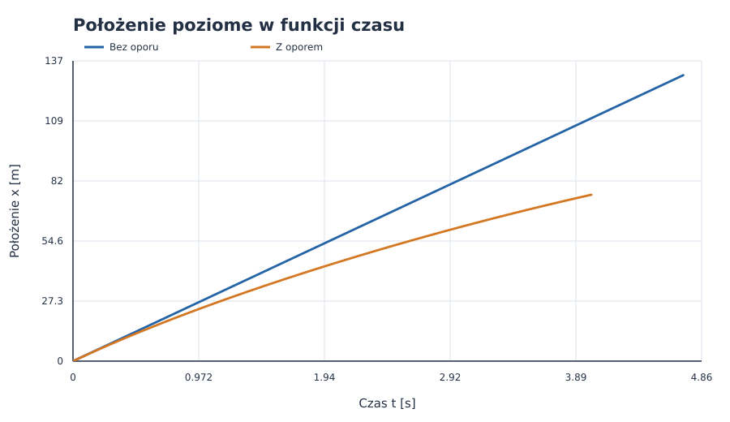
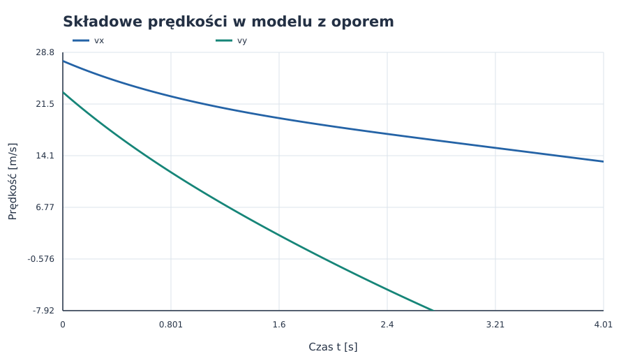
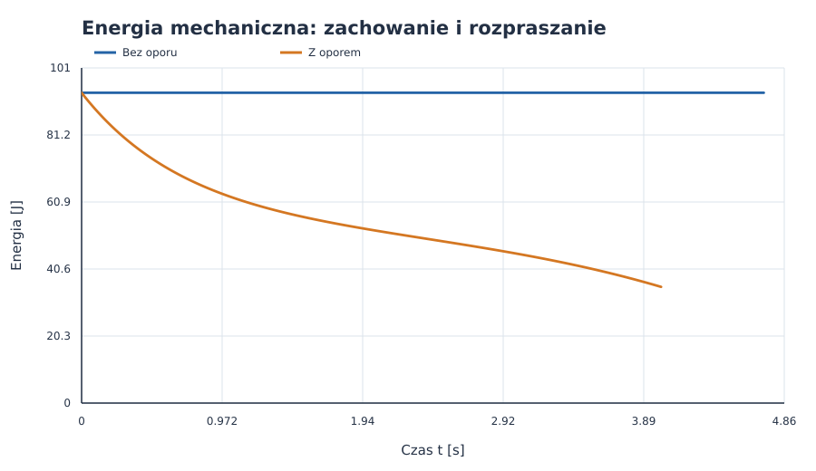

# Rzut ukośny bez oporu i z oporem powietrza

**Dane z indeksu:** prędkość początkowa $v_0=36\ \mathrm{m/s}$, kąt $\alpha=40^\circ$.<br>
**Metoda:** rozwiązanie analityczne dla ruchu bez oporu oraz numeryczna symulacja oporu aerodynamicznego.<br>
**Charakter danych:** wyniki modelowe, nie pomiar laboratoryjny.

## Spis treści

1. [Cel i założenia](#1-cel-i-założenia)
2. [Rzut ukośny bez oporu powietrza](#2-rzut-ukośny-bez-oporu-powietrza)
3. [Rzut ukośny z oporem powietrza](#3-rzut-ukośny-z-oporem-powietrza)
4. [Metoda obliczeń i wyniki](#4-metoda-obliczeń-i-wyniki)
5. [Wykresy i interpretacja](#5-wykresy-i-interpretacja)
6. [Kod i odtwarzanie wyników](#6-kod-i-odtwarzanie-wyników)
7. [Ograniczenia modelu](#7-ograniczenia-modelu)
8. [Wnioski](#8-wnioski)
9. [Źródła](#9-źródła)

---

## 1. Cel i założenia

Rzut ukośny jest ruchem w dwóch wymiarach. W pobliżu powierzchni Ziemi, jeśli pominiemy opór powietrza, składowa pozioma prędkości pozostaje stała, a składowa pionowa zmienia się pod wpływem grawitacji. Opór powietrza zmienia obie składowe i powoduje utratę energii mechanicznej.

Przyjmujemy układ współrzędnych, w którym oś $x$ jest pozioma, a oś $y$ skierowana pionowo w górę. Początek układu znajduje się w miejscu wyrzutu, a poziom lądowania ma $y=0$.

### 1.1. Założenia

- Pocisk startuje z poziomu gruntu z prędkością $v_0=36\ \mathrm{m/s}$ pod kątem $\alpha=40^\circ$.
- Przyspieszenie grawitacyjne jest stałe: $g=9{,}81\ \mathrm{m/s^2}$.
- W modelu idealnym nie ma oporu powietrza.
- W modelu z oporem pocisk jest kulą o masie $m=0{,}145\ \mathrm{kg}$ i średnicy $d=0{,}073\ \mathrm{m}$.
- Powietrze ma stałą gęstość $\rho=1{,}225\ \mathrm{kg/m^3}$, a współczynnik oporu kuli wynosi $C_D=0{,}47$.
- Wiatr, wypór powietrza, obrót pocisku i zmiany gęstości powietrza pomijamy.

Wartości masy i średnicy opisują przykładową piłkę. Są dodatkowymi założeniami modelu, ponieważ sam indeks określa tylko $v_0$ i $\alpha$.

### 1.2. Symbole i jednostki

| Symbol | Znaczenie | Jednostka SI |
| :--- | :--- | :---: |
| $x$, $y$ | współrzędne położenia | $\mathrm{m}$ |
| $t$ | czas | $\mathrm{s}$ |
| $v_x$, $v_y$, $v$ | składowe i wartość prędkości | $\mathrm{m/s}$ |
| $a_x$, $a_y$, $g$ | składowe przyspieszenia i przyspieszenie grawitacyjne | $\mathrm{m/s^2}$ |
| $v_0$ | wartość prędkości początkowej | $\mathrm{m/s}$ |
| $\alpha$ | kąt wyrzutu | $\mathrm{rad}$ (w danych podany jako $40^\circ$) |
| $m$ | masa pocisku | $\mathrm{kg}$ |
| $A$ | pole przekroju poprzecznego kuli | $\mathrm{m^2}$ |
| $\rho$ | gęstość powietrza | $\mathrm{kg/m^3}$ |
| $C_D$ | bezwymiarowy współczynnik oporu | $1$ |
| $F_D$ | siła oporu powietrza | $\mathrm{N}$ |

W obliczeniach numerycznych kąt zamieniamy na radiany: $\alpha=40^\circ=0{,}6981\ \mathrm{rad}$.

## 2. Rzut ukośny bez oporu powietrza

### 2.1. Rozkład prędkości początkowej

Prędkość początkowa tworzy z poziomem kąt $\alpha$, zatem jej składowe wynoszą:

$$
v_{x0}=v_0\cos\alpha,\qquad v_{y0}=v_0\sin\alpha.
$$

Dla podanych danych:

$$
v_{x0}=36\cos 40^\circ=27{,}578\ \mathrm{m/s},
\qquad
v_{y0}=36\sin 40^\circ=23{,}140\ \mathrm{m/s}.
$$

### 2.2. Równania ruchu

Z drugiej zasady Newtona, przy braku siły poziomej i przy sile ciężkości $F_g=-mg$:

$$
m\ddot{x}=0,\qquad m\ddot{y}=-mg.
$$

Po podzieleniu przez masę otrzymujemy równania przyspieszenia:

$$
\ddot{x}=0,\qquad \ddot{y}=-g.
$$

Całkujemy równania, wykorzystując warunki początkowe $x(0)=y(0)=0$, $\dot{x}(0)=v_{x0}$ i $\dot{y}(0)=v_{y0}$:

$$
x(t)=v_0\cos\alpha\,t,
\qquad
y(t)=v_0\sin\alpha\,t-\frac{gt^2}{2}.
$$

Różniczkując po czasie, dostajemy składowe prędkości:

$$
v_x(t)=v_0\cos\alpha,\qquad
v_y(t)=v_0\sin\alpha-gt.
$$

### 2.3. Tor, czas lotu, zasięg i wysokość

Z równania poziomego $t=x/(v_0\cos\alpha)$. Po podstawieniu do równania pionowego otrzymujemy równanie toru:

$$
y(x)=x\tan\alpha-\frac{gx^2}{2v_0^2\cos^2\alpha}.
$$

Jest to parabola. Czas lotu wyznaczamy z warunku lądowania $y(t)=0$. Rozwiązania to chwila startu $t=0$ oraz druga chwila:

$$
t_{\mathrm{lot}}=\frac{2v_0\sin\alpha}{g}
=\frac{2\cdot36\sin40^\circ}{9{,}81}
=4{,}718\ \mathrm{s}.
$$

Zasięg poziomy to położenie w chwili lądowania:

$$
R=x(t_{\mathrm{lot}})
=v_0\cos\alpha\cdot\frac{2v_0\sin\alpha}{g}
=\frac{v_0^2\sin(2\alpha)}{g}
=130{,}103\ \mathrm{m}.
$$

W najwyższym punkcie $v_y=0$. Stąd $t_H=v_0\sin\alpha/g=2{,}359\ \mathrm{s}$, a wysokość maksymalna:

$$
H=\frac{v_0^2\sin^2\alpha}{2g}
=27{,}292\ \mathrm{m}.
$$

**Kontrola jednostek:** w wyrażeniu $v_0^2/g$ jednostką jest $(\mathrm{m^2/s^2})/(\mathrm{m/s^2})=\mathrm{m}$, zgodnie z jednostką zasięgu i wysokości.

## 3. Rzut ukośny z oporem powietrza

### 3.1. Model siły oporu

Przyjmujemy kwadratowy model oporu aerodynamicznego. Siła oporu ma zwrot przeciwny do prędkości, a jej wartość zależy od kwadratu szybkości:

$$
\vec{F}_D=-\frac{1}{2}\rho C_D A\,|\vec{v}|\,\vec{v},
\qquad
|\vec{v}|=\sqrt{v_x^2+v_y^2}.
$$

Dla kuli pole przekroju poprzecznego wynosi:

$$
A=\pi\left(\frac{d}{2}\right)^2
=\pi(0{,}0365\ \mathrm{m})^2
=0{,}004185\ \mathrm{m^2}.
$$

Współczynnik stojący przy $|\vec v|\vec v$:

$$
c=\frac{1}{2}\rho C_D A
=0{,}001205\ \mathrm{kg/m}.
$$

### 3.2. Równania ruchu z oporem

Rozpisujemy drugą zasadę Newtona na kierunek poziomy i pionowy:

$$
m\dot{v}_x=-c|\vec v|v_x,
\qquad
m\dot{v}_y=-mg-c|\vec v|v_y.
$$

Równoważny układ równań pierwszego rzędu, który rozwiązujemy numerycznie, ma postać:

$$
\dot{x}=v_x,\qquad \dot{y}=v_y,
$$

$$
\dot{v}_x=-\frac{c}{m}\sqrt{v_x^2+v_y^2}\,v_x,
\qquad
\dot{v}_y=-g-\frac{c}{m}\sqrt{v_x^2+v_y^2}\,v_y.
$$

Warunki początkowe pozostają takie same jak w modelu idealnym. Podczas wznoszenia opór zmniejsza składową pionową prędkości. Podczas opadania siła oporu działa ku górze, przeciwnie do ruchu. W obu fazach składowa pozioma prędkości maleje.

W przeciwieństwie do modelu bez oporu układ z kwadratową siłą oporu nie prowadzi tu do prostych wzorów na czas lotu i zasięg. Rozwiązanie przybliżamy metodą Rungego–Kutty czwartego rzędu (RK4), krokami $\Delta t=0{,}002\ \mathrm{s}$.

## 4. Metoda obliczeń i wyniki

Symulację kończymy w chwili, gdy $y$ zmienia znak z dodatniego na ujemny. Ostatni krok interpolujemy liniowo, aby oszacować moment przecięcia poziomu $y=0$. Wysokość maksymalna jest największą wartością $y$ w obliczonym przebiegu.

| Wielkość | Bez oporu | Z oporem |
| :--- | ---: | ---: |
| Czas lotu $t_{\mathrm{lot}}$ | $4{,}718\ \mathrm{s}$ | $4{,}007\ \mathrm{s}$ |
| Zasięg $R$ | $130{,}103\ \mathrm{m}$ | $75{,}706\ \mathrm{m}$ |
| Wysokość maksymalna $H$ | $27{,}292\ \mathrm{m}$ | $19{,}870\ \mathrm{m}$ |
| Czas osiągnięcia maksymalnej wysokości | $2{,}359\ \mathrm{s}$ | $1{,}882\ \mathrm{s}$ |

W modelu z oporem zasięg jest mniejszy o około $41{,}8\%$, a wysokość maksymalna o około $27{,}2\%$ w porównaniu z modelem idealnym. Są to wyniki dla przyjętych parametrów kuli i powietrza.

## 5. Wykresy i interpretacja

### 5.1. Tor ruchu



*Rysunek 1. Opór skraca zasięg i obniża maksymalną wysokość. W modelu bez oporu tor jest parabolą.*

### 5.2. Wysokość w czasie



*Rysunek 2. Z oporem pocisk szybciej osiąga niższą wysokość maksymalną i wcześniej wraca na poziom startu.*

### 5.3. Położenie poziome w czasie



*Rysunek 3. Bez oporu $x(t)$ rośnie liniowo. Z oporem prędkość pozioma maleje, dlatego wykres nie jest linią prostą.*

### 5.4. Składowe prędkości z oporem



*Rysunek 4. Składowa pionowa zmienia znak w najwyższym punkcie toru. Składowa pozioma pozostaje dodatnia, ale maleje wskutek oporu.*

### 5.5. Energia mechaniczna



*Rysunek 5. W modelu idealnym suma energii kinetycznej i potencjalnej jest stała. Opór wykonuje pracę ujemną i rozprasza energię mechaniczną.*

Dla modelu idealnego energia mechaniczna ma wartość:

$$
E=E_k+E_p=\frac{1}{2}mv^2+mgy=\mathrm{const}.
$$

W chwili startu, przy $y=0$, wynosi $E_0=\tfrac12mv_0^2=94{,}0\ \mathrm{J}$. Przy oporze część energii mechanicznej przechodzi w energię wewnętrzną powietrza i pocisku.

## 6. Kod i odtwarzanie wyników

Pełny, uruchamialny skrypt generujący pięć powyższych wykresów znajduje się w pliku [`generuj_wykresy.py`](generuj_wykresy.py). Korzysta wyłącznie ze standardowej biblioteki Pythona.

```python
from math import hypot, pi, radians, sin, cos

v0, alpha_deg = 36.0, 40.0
g, mass = 9.81, 0.145
rho, cd, diameter = 1.225, 0.47, 0.073
area = pi * (diameter / 2) ** 2
c = 0.5 * rho * cd * area
dt = 0.002
alpha = radians(alpha_deg)

# Stan: (x, y, vx, vy), a opór jest przeciwny do wektora prędkości.
state = (
    0.0, 0.0,
    v0 * cos(alpha),
    v0 * sin(alpha),
)

def derivative(state):
    _, _, vx, vy = state
    speed = hypot(vx, vy)
    factor = c * speed / mass
    return vx, vy, -factor * vx, -g - factor * vy

def rk4_step(state, dt):
    def add_scaled(values, slope, factor):
        return tuple(v + factor * d for v, d in zip(values, slope))

    k1 = derivative(state)
    k2 = derivative(add_scaled(state, k1, dt / 2))
    k3 = derivative(add_scaled(state, k2, dt / 2))
    k4 = derivative(add_scaled(state, k3, dt))
    return tuple(
        value + dt * (a + 2*b + 2*c + d) / 6
        for value, a, b, c, d in zip(state, k1, k2, k3, k4)
    )
```

W pliku skryptu znajduje się również rozwiązanie analityczne ruchu bez oporu, pętla symulacji do chwili lądowania, obliczanie wyników oraz kod zapisujący wykresy SVG. Uruchomienie z głównego katalogu repozytorium:

```bash
python3 pages/solutions/04_sol_vscode/generuj_wykresy.py
```

Wygenerowane obrazy zapisują się w folderze [`wykresy/`](wykresy/).

## 7. Ograniczenia modelu

- Współczynnik $C_D$ i gęstość powietrza przyjęto jako stałe. W rzeczywistości opór zależy m.in. od kształtu, orientacji, prędkości i właściwości powietrza.
- Pominięto wiatr, obrót i siłę Magnusa, która może mieć znaczenie dla obracającej się piłki.
- Zakładamy lądowanie na tej samej wysokości, z której nastąpił wyrzut.
- Wyniki modelu z oporem są przybliżone numerycznie; zmniejszenie kroku całkowania pozwala sprawdzić wpływ kroku na dokładność.

## 8. Wnioski

1. Bez oporu powietrza ruch poziomy jest jednostajny, a pionowy jednostajnie przyspieszony. Po eliminacji czasu tor ma kształt paraboli.
2. Dla $v_0=36\ \mathrm{m/s}$ i $\alpha=40^\circ$ model idealny przewiduje zasięg $130{,}103\ \mathrm{m}$ oraz wysokość maksymalną $27{,}292\ \mathrm{m}$.
3. Opór aerodynamiczny działa przeciwnie do wektora prędkości. Podczas wznoszenia zmniejsza składową pionową prędkości, a podczas opadania ogranicza szybkość opadania. W całym locie zmniejsza składową poziomą, przez co skraca zasięg. Dla przyjętej kuli zasięg wynosi  $75{,}706\ \mathrm{m}$.
4. W modelu idealnym energia mechaniczna pozostaje stała. W modelu z oporem maleje, ponieważ siła oporu rozprasza energię.
5. Wykresy i wartości liczbowe można odtworzyć skryptem Python zapisanym obok raportu.

## 9. Źródła

- OpenStax, [Projectile Motion](https://openstax.org/books/college-physics-2e/pages/3-4-projectile-motion) — równania ruchu pocisku bez oporu.
- NASA Glenn Research Center, [The Drag Equation](https://www1.grc.nasa.gov/beginners-guide-to-aeronautics/drag-equation/) — równanie oporu aerodynamicznego.
- J. R. Taylor, *Classical Mechanics*, University Science Books — równania ruchu i metody numeryczne.
